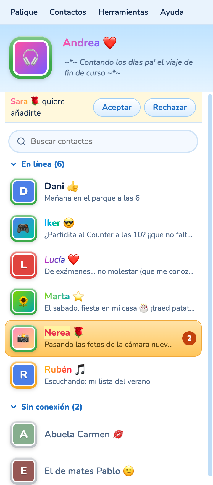
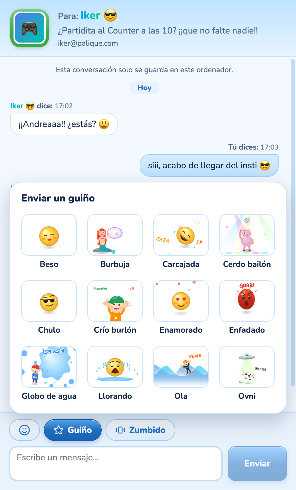
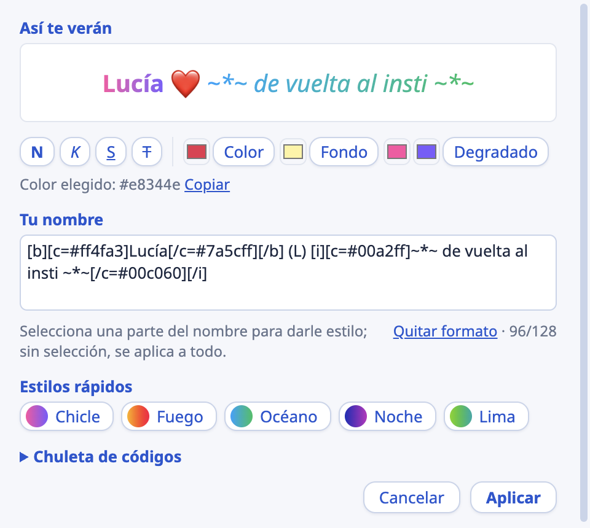
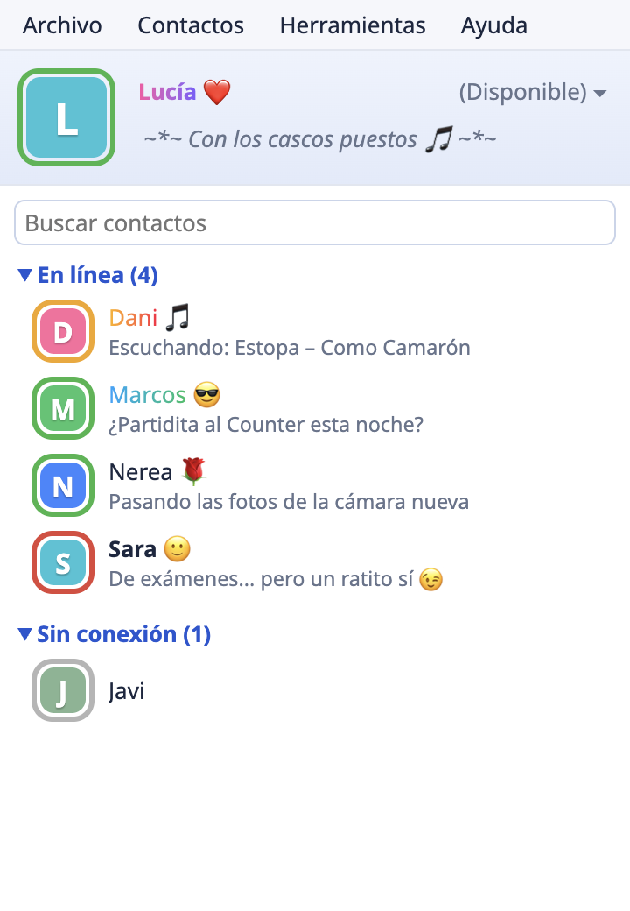
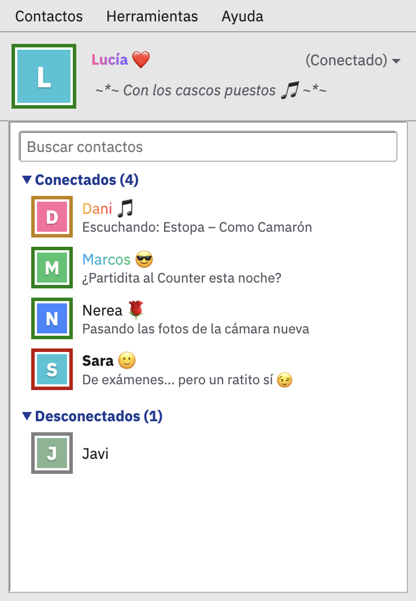
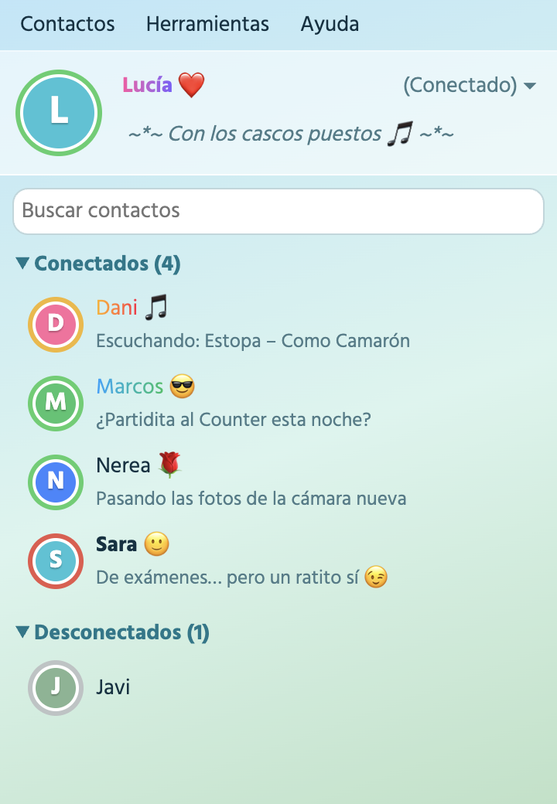
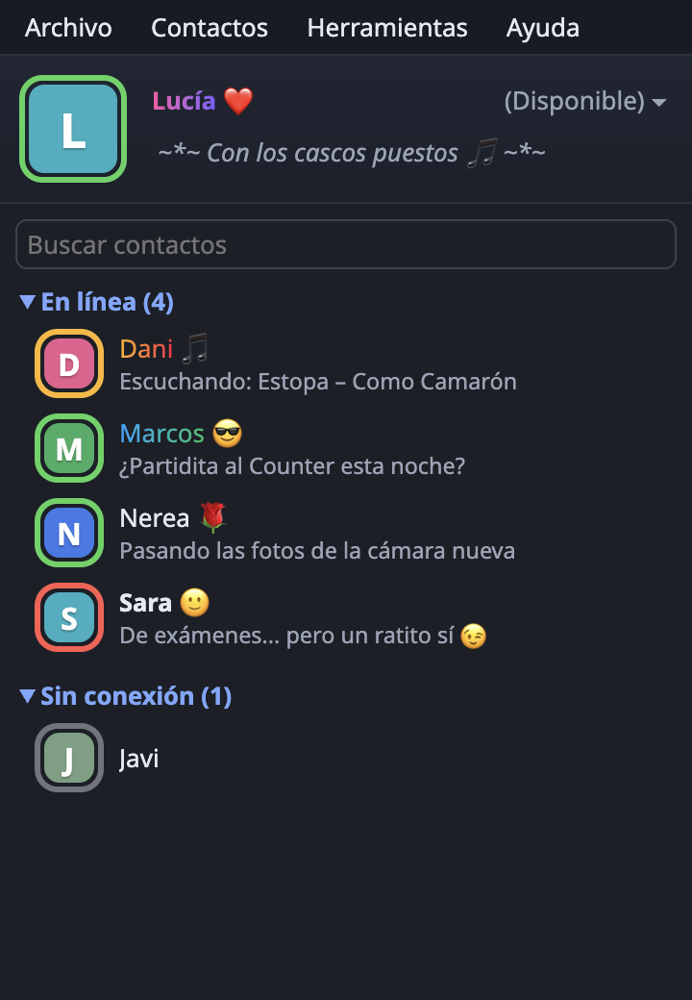
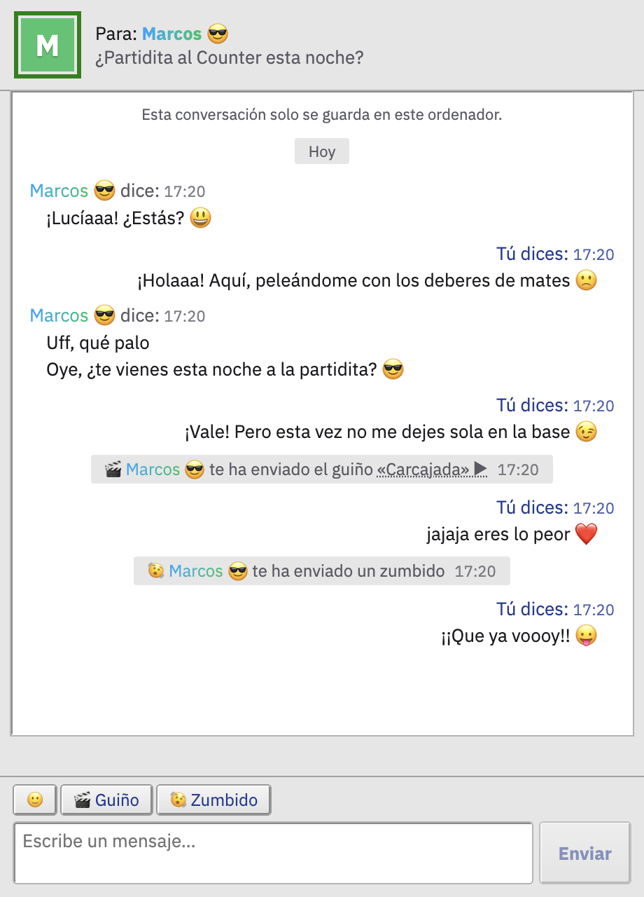
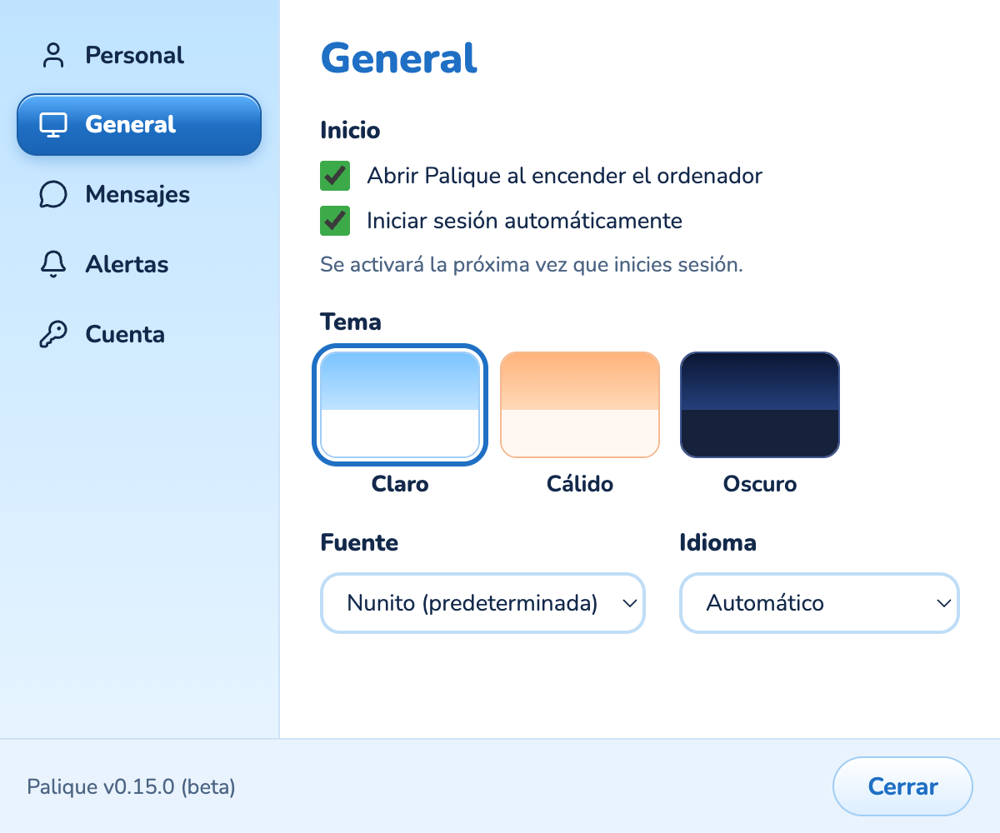
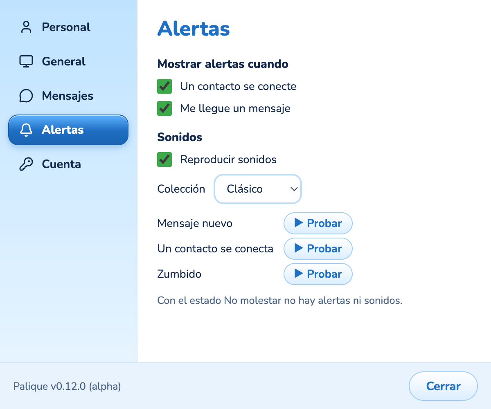

# Palique

**El messenger de toda la vida, hecho de nuevo.**

Tu lista de contactos, tu mensaje personal, los zumbidos, los guiños… 
y ese sonidito de cuando alguien se conecta.

[**Descargar**](https://github.com/pauferr/palique/releases) · [Cómo empezar](#cómo-empezar) · [Contribuir](#contribuir)

macOS · Windows · Linux &nbsp;—&nbsp; en alpha, por invitación, mientras lo probamos entre amigos

 

&nbsp;&nbsp;

 

## ¿Por qué Palique?

¿Te acuerdas de llegar a casa, encender el ordenador y ver quién estaba conectado? De cambiar tu frase cada tarde, de mandar un zumbido porque alguien tardaba en contestar, de que se te iluminara la lista en naranja cuando por fin te escribían.

Palique quiere recuperar eso. Un sitio pequeño y tranquilo para hablar con tus amigos, sin nada más alrededor.

- **El móvil puede esperar.** Palique vive en el ordenador, para charlar con calma mientras haces tus cosas.
- **Solo tus amigos.** Nadie te escribe si tú no le agregas. Se entra por invitación, de amigo a amigo.
- **Sin feeds ni algoritmos.** No hay nada que deslizar, nada que te enganche, ningún anuncio. Solo conversaciones.
- **Tus cosas son tuyas.** Las conversaciones se guardan en tu ordenador, no en un servidor, y tu correo solo lo ven los contactos que tú también tienes agregados.
- **Con cariño y con ruido.** Zumbidos, guiños, emoticonos y sonidos, porque hablar con tus amigos tiene que ser divertido.
- **Libre, de verdad.** Palique es software libre: cualquiera puede ver el código, cambiarlo y montar su propio servidor, y lo que se haga a partir de Palique tiene que seguir siendo libre.

## Lo que trae

<table>
  <tr>
    <td width="50%">
      <h3>Tu lista de contactos</h3>
      
Quién está conectado, quién se ha ido a merendar y quién está de exámenes, cada uno con su mensaje personal. Cuando alguien te escribe, su nombre parpadea en naranja hasta que lo abres. Y un buscador para encontrar a cualquiera.

    </td>
    <td width="50%">
      <h3>Conversaciones con chispa</h3>
      
Zumbidos que hacen temblar la ventana entera, guiños a pantalla completa, los emoticonos de siempre y el mítico «está escribiendo…» mientras esperas el mensaje de la persona que te gusta 🤪

    </td>
  </tr>
  <tr>
    <td align="center"></td>
    <td align="center"></td>
  </tr>
  <tr>
    <td>
      <h3>Doce guiños, dibujados a mano</h3>
      
Del beso al cerdo bailón, pasando por el globo de agua. Se ven nítidos a cualquier tamaño y suenan con su propia musiquilla.

    </td>
    <td>
      <h3>Tu nombre, con colores y degradados</h3>
      
¿Te acuerdas de los nombres de colores de Messenger Plus!? Aquí vienen de serie: negrita, colores, fondos y degradados, o un estilo rápido con un clic.

    </td>
  </tr>
</table>

### Cuatro temas

Clásico, con los azules de los 2000. Retro, como un escritorio de los 90. Cristal, todo cielo, hierba y brillo. Y Noche, el tema oscuro, para cuando se apagan las luces.

  
  
  
  

  
  
  

### A tu manera

Elige tu fuente (sí, también hay una al estilo Comic Sans), tu colección de sonidos y tu estado: Disponible, Ausente, No molestar o Invisible.

  
  

## Cómo empezar

1. **Consigue una invitación.** Por ahora solo se entra si alguien te invita, y la invitación te llega por correo.
2. **Instala Palique** desde [Releases](https://github.com/pauferr/palique/releases) (macOS, Windows y Linux). Se actualiza sola en Windows y Linux; en macOS te avisa cuando hay una versión nueva. Todavía no está firmada, así que la primera vez:
   - En macOS no se abrirá: ve a *Ajustes del Sistema → Privacidad y seguridad* y pulsa *Abrir igualmente*.
   - En Windows, elige *Más información → Ejecutar de todas formas*.
3. **Crea tu cuenta.** Pulsa el botón del correo de invitación, o abre Palique, elige *¿Tienes una invitación? Crea tu cuenta* y pega el código. Elige tu nombre y una contraseña; entrarás con el correo al que te llegó la invitación.
4. **Añade a tus amigos** con su correo. ¿Alguien aún no está en Palique? Invítale (tienes 3 invitaciones) y, en cuanto entre, ya estaréis agregados.
5. **¡A chatear!** Y si alguien tarda en contestar, ya sabes: zumbido.

## Contribuir

Palique es un proyecto pequeño y personal, hecho con cariño. Si te apetece echar una mano:

- [AGENTS.md](AGENTS.md): la documentación técnica (arquitectura, cómo desarrollar, comprobaciones, versiones y despliegue).
- [CONTRIBUTING.md](CONTRIBUTING.md): las convenciones de commits.
- [docs/palique.md](docs/palique.md): el plan del proyecto y las decisiones de diseño.
- [docs/deployment.md](docs/deployment.md): cómo montar tu propio servidor de Palique.

## Licencia

Palique es software libre, con licencia [GNU AGPL v3](LICENSE) o posterior. Puedes usarlo, estudiarlo, cambiarlo y compartirlo; si distribuyes una versión modificada, o la ofreces a otros desde un servidor, tienes que compartir también su código con la misma licencia.

 

Hecho con cariño para los que crecimos esperando un zumbido.

